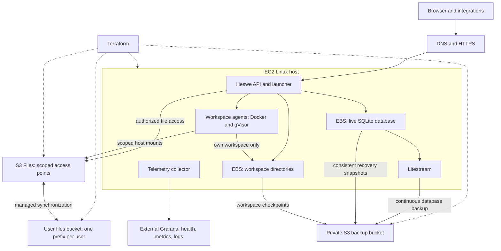

# Hosted infrastructure with Terraform and S3 Files

Status: proposal. The app has a single-server gVisor launcher. Terraform
deployment, S3 Files mounts, automated backups, and infrastructure dashboards
are not implemented.

## Direction

Start with one reproducible AWS installation: an EC2 Linux host, persistent
local storage for live platform state, S3 backups of that state, S3 Files for
shared user files, and Grafana for monitoring. Keep ordinary local development
unchanged.

Use the current Docker and gVisor launcher first. Remote workspace computers
can follow the same storage grants when the remote launcher is implemented.
Do not require Kubernetes or a separate scheduling service for this deployment.



Solid arrows show application and data paths. Dotted arrows show provisioning.
S3 Files mounts live on the trusted host; agents receive scoped bind mounts.
The diagram describes the hosted app path. Moving Slack and Telegram execution
behind the same launcher remains work in [agent computers](agent-computer-runtime.md).

## Ownership

| Owner | Responsibility |
| --- | --- |
| Terraform | Network, host, disks, buckets, S3 Files, mount targets, common permissions, DNS, backup resources, dashboards and alerts |
| Deployment tooling | Build images, configure services, mount storage, load secrets, deploy a selected release, verify readiness |
| Heswe API and launcher | Authorize users, create file grants and their access points, assign workspace computers, deliver work, stop and clean up compute |

Terraform owns shared infrastructure. Heswe owns resources created for user
and workspace lifecycles, including scoped access points recorded in the
registry. Do not manage the same resource through both paths or run Terraform
for each agent start. The browser cannot supply a mount path or access point.

## Fast setup and updates

Build a versioned server image with Packer: Node, Docker, gVisor, Litestream,
the S3 Files mount helper, an HTTPS proxy, and the telemetry collector. Publish
the app release and reviewed workspace image as prepared artifacts. Pin versions
and image digests so a new host does not compile the app or install dependencies.

Keep the deployment configuration small: platform name, region, domain, host
capacity, and release. Use this initial layout:

```text
infra/
  bootstrap/       # Remote Terraform state and deployment identity
  aws/             # Shared AWS infrastructure
  environments/    # Configuration for each installation
  images/          # Packer builds
  server/          # Cloud-init and systemd service configuration
  observability/   # Dashboards and alerts
  scripts/         # Setup, release deployment, health and recovery
```

Bootstrap the account, remote backend, DNS access, and CI identity once.
Then a setup command runs Terraform, configures the host, and waits for API,
storage, and sandbox checks before reporting the installation ready.
Run services under systemd and require the data disk and granted mounts to be
present before starting them. Fail startup instead of writing into an empty
directory when a mount fails.

Use cloud-init for initial host configuration. Application upgrades run through
an explicit deployment job with rollback to the previous release; changing
cloud-init is not an application update mechanism. Host replacement must stop
the old writer before attaching its data disk to a replacement.

Keep separate Terraform state for each installation and for bootstrap resources.
Use a versioned S3 backend with [native locking](https://developer.hashicorp.com/terraform/language/backend/s3).
Keep state, shared user storage, and backup resources outside ordinary host
teardown. CI runs plans for review and applies the selected plan through one
serialized deployment path.
Use short-lived deployment credentials and fetch application secrets at startup.
Do not embed secret values in images, cloud-init, or published Terraform output.

## Storage and sharing

Choose [S3 Files](https://docs.aws.amazon.com/AmazonS3/latest/userguide/s3-files.html)
for shared user files. Use one versioned user-data bucket per installation:

```text
users/<opaque-user-id>/files/
  projects/<project-id>/
  shared/
```

Keep live data and recovery copies explicit:

| Data | Live location | Recovery copy |
| --- | --- | --- |
| Accounts, sessions, workspace ownership and assignments | SQLite at `/srv/heswe/platform/heswe.sqlite` on encrypted EBS; API only | Litestream replica under `sqlite/` in the private S3 backup bucket, plus consistent recovery snapshots |
| Agent configuration, workspace provider keys and chat history | `/srv/heswe/workspaces/<workspace-id>` on EBS, mounted as `/workspace` in its computer | Checkpoints under `workspaces/` in the private S3 backup bucket |
| User documents, uploads and published outputs | Scoped S3 Files mounts under `/files`, linked to the user-data bucket | S3 object versions after synchronization; filesystem metadata and pending changes follow the storage recovery procedure |
| Temporary files, builds and caches | Local scratch under `/tmp` | None; recreate them |
| Terraform state | Separate versioned S3 backend bucket | Retained object versions, with access restricted to infrastructure operators |
| Platform authentication and service secrets | AWS Secrets Manager, loaded by the trusted host | Retained independently of the host, with deletion recovery configured |

These host paths are proposed deployment defaults. Configure the API database
and workspace root accordingly. Initially, both directories use one encrypted
EBS data volume retained independently of the EC2 instance. Chat history remains
in workspace files; it does not move into the API database. Keep the user-data,
private backup, and Terraform state buckets separate. Agents never mount the
latter two.
Supply platform secrets from [AWS Secrets Manager](https://docs.aws.amazon.com/secretsmanager/latest/userguide/intro.html)
at startup. Keep its resources outside host teardown and preserve the secret
versions needed by retained recovery sets. Workspace provider keys remain
private to their workspace and its backups.

Several computers can read the same project and write separate run outputs.
Start with read-only shared inputs and one publisher for changes to shared
project files. Filesystem locking does not merge edits or make a shared Git
checkout safe for independent concurrent mutation.

Browser uploads, downloads, and edits use the same filesystem through an
authorized API; shared-file mutations go through the publisher. Add storage
mapping for the existing scoped browser references and migrate current assets
and thread uploads before switching their storage. Existing message attachments
must still resolve without exposing host paths or widening their access grants.
S3 Files exports to the bucket asynchronously, so direct S3 writes are not a
second application write path. Runtime checkpoint recovery is separate from
S3 Files synchronization and storage lifecycle.

[Workspace sandboxing and storage](workspace-agent-sandboxing.md) defines
grant enforcement, synchronization, checkpoints, and concurrent writes.

## Database backups and recovery

Keep the live SQLite database on the persistent disk. The API currently uses
WAL mode, which [SQLite does not support over a network filesystem](https://www.sqlite.org/wal.html).
Neither a raw S3 mount nor S3 Files is the live database location.

Run a pinned [Litestream](https://litestream.io/how-it-works/) version as a
host service to continuously replicate database changes to S3 through its API.
This is asynchronous disaster recovery, not another database writer or automatic
failover. Configure the replication interval, monitor confirmed remote progress,
and report the latest recoverable point. A lost disk can lose changes that have
not reached S3; do not promise zero data loss.

Use SQLite's [online backup API](https://www.sqlite.org/backup.html) for database
snapshots. Do not copy just the live `.sqlite` file while WAL writes continue.
Create periodic complete recovery sets and one before destructive migrations:

1. Pause platform mutations and drain workspace writers. Capture a consistent
   database snapshot and stable workspace checkpoints, then resume service.
2. Upload the captured data under a new recovery generation. Verify checksums
   and record the database snapshot and workspace checkpoint IDs in a manifest.
3. Mark the generation complete only when every referenced object is present.
   Retain the previous complete set if any upload fails.

Independent Litestream uploads and workspace checkpoints do not form an atomic
platform backup. A full platform restore starts from a complete matching
recovery set. Use a newer database replica only after reconciling workspace
records and files; do not silently create empty workspaces for missing data.
Shared user files have their own version history and synchronization boundary;
this recovery set does not promise a transaction across S3 Files and SQLite.

On recovery, fence the old host, restore onto a fresh or retained EBS volume,
check SQLite integrity, and restore the matching workspace state to the stable
host paths stored in the registry. Reconcile grants, mount S3 Files, and start
the API only after validation. An established installation must fail startup
when its database is missing and restoration fails, rather than create a new
empty database. Planned replacement first stops writes and confirms the final
backup upload before discarding the old disk.

Encrypt private backups and restrict access to the backup service and recovery
operators. Retention must preserve complete recovery sets and the snapshots and
log chains Litestream needs. Run restore drills on a separate volume and verify
sign-in, workspace ownership, history, and file access. Surface replication lag,
failed checkpoints, and restore-check results in Grafana.

## Monitoring and the infrastructure map

Send host and container metrics and operational logs through Grafana Alloy to
an external Grafana stack. Add API health and launcher metrics; do not log
conversation content or credentials. Monitoring must remain reachable when
the application host fails.

| View | Contents |
| --- | --- |
| Infrastructure map | Host, disks, S3 Files, buckets and dependencies, generated from allowlisted infrastructure inventory |
| Live dashboard | API health, latency and errors; CPU, memory and disk; agent starts and failures; database replication lag, complete recovery-set age, restore-check results and S3 Files sync failures |
| Workspace inventory | Workspace assignment, computer state, last heartbeat, granted access points and checkpoint generation |

[Terraform graph](https://developer.hashicorp.com/terraform/cli/commands/graph)
can supply a configuration dependency view. Live status comes from telemetry
and Heswe's registry. Keep dashboard definitions in Git and provision them
with the installation. Publish selected resource IDs and relationships rather
than raw Terraform state, which can contain secrets.

Start with standard Grafana dashboards and the generated map. An interactive
topology can later join that inventory with live health and workspace placement.

## Cost and other hosts

S3 Files charges for active filesystem storage, data and metadata operations,
and synchronization, in addition to S3 storage, requests, and retained versions.
Savings depend on the working set and access pattern. Measure document edits,
small-file browsing, and shared reads against EFS before claiming a saving.
See [metering](https://docs.aws.amazon.com/AmazonS3/latest/userguide/s3-files-metering.html)
and [pricing](https://aws.amazon.com/s3/pricing/).

Our own Linux hosts can reuse the release and service configuration. A later
Terraform root can provision VMs through the chosen provider or hypervisor API;
existing bare-metal hosts need configuration tooling. S3 Files remains an AWS
service and requires private connectivity to its mount targets. Prove mounting,
latency, and recovery from that network before supporting this deployment.

The first installation has one API process and downtime during host recovery.
More agent hosts need the authenticated remote worker and scoped file paths in
[platforms and instances](platforms-and-workspace-instances.md). Multiple API
writers also need shared database and event delivery support.

## First implementation

1. Add image builds, Terraform bootstrap, and one AWS installation.
2. Mount a scoped S3 Files directory alongside `/workspace` in the existing
   gVisor launcher; route browser file access through the same storage path.
3. Add grant and access-point lifecycle, explicit container cleanup, coordinated
   publication, Litestream replication, and complete recovery sets for local state.
4. Provision dashboards, alerts, and a generated infrastructure map.
5. Prove a fresh install, a clean second Terraform plan, cross-user isolation,
   denied ungranted mounts, shared reads, and disjoint output writes.
6. Prove host replacement and recovery from S3 without the original disk, failed
   mounts and backups, writer fencing, grant revocation, visible sync failures,
   and startup refusal when required recovery data is missing before rollout.
